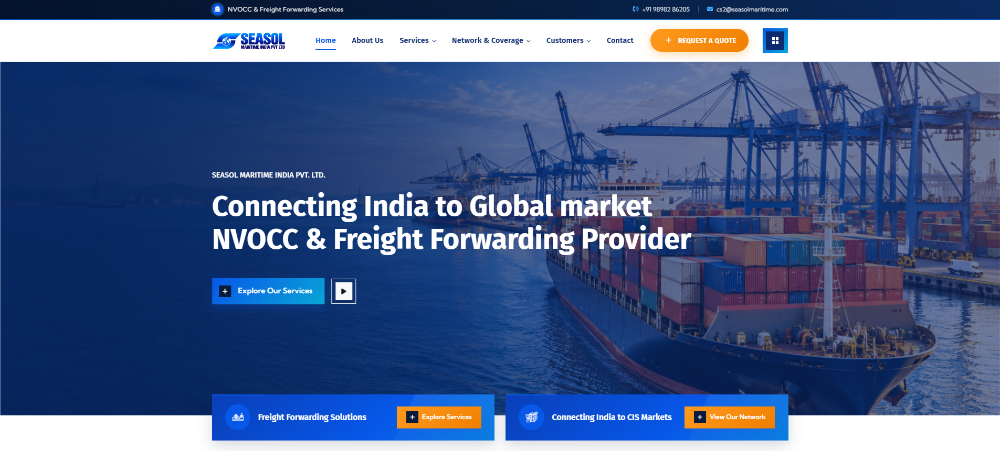
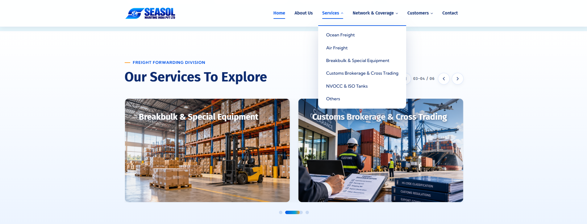
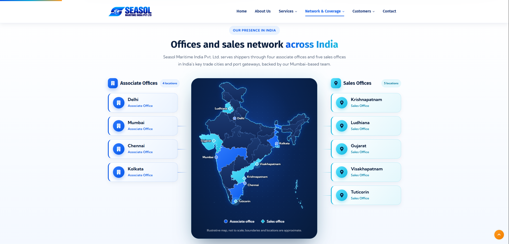
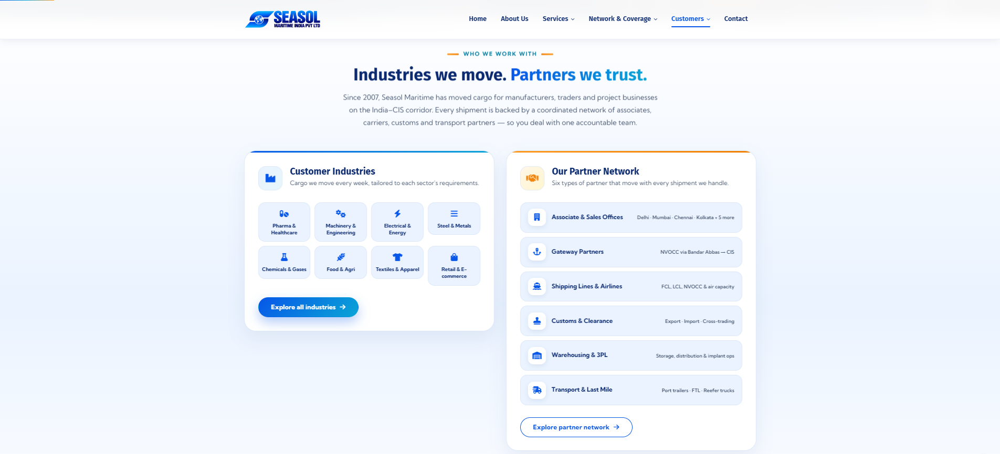
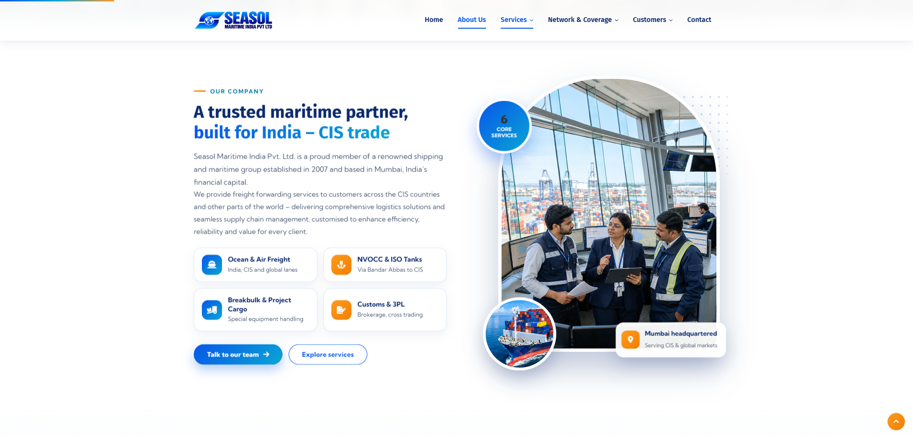
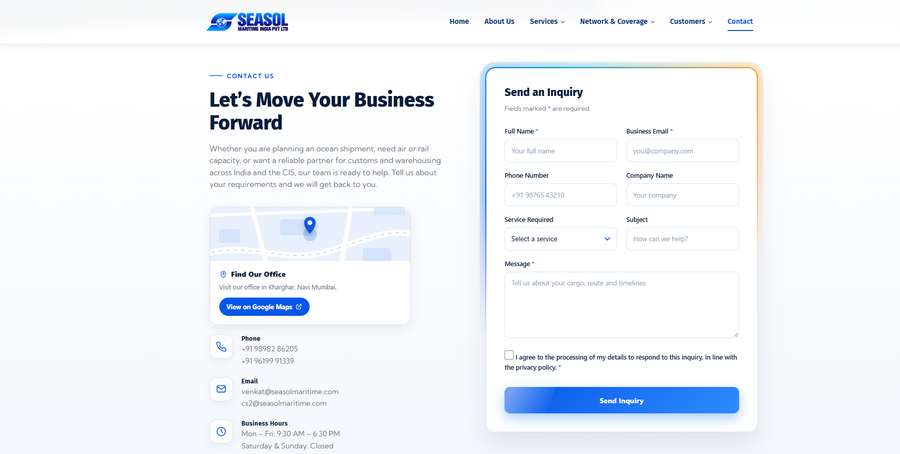

<div align="center">

# ⚓ SEASOL MARITIME INDIA PVT. LTD.

### Connecting Businesses. Moving the World.

**Corporate Website | Maritime Logistics | Freight Solutions**


</div>

---

## 🌐 About The Project

A modern, responsive corporate website developed for **Seasol Maritime India Pvt. Ltd.**

The website showcases the company's maritime logistics, freight forwarding services, international network, customers, and business solutions through a premium and user-friendly interface.

Built using HTML, CSS, JavaScript, Bootstrap, and jQuery.

---

## ✨ Website Highlights

- Modern and responsive homepage.
- Premium corporate design and animations.
- Ocean Freight and Air Freight services.
- Customs Brokerage solutions.
- NVOCC & ISO Tank services.
- Breakbulk & Special Equipment.
- International Network and country coverage.
- Customers & Partners section.
- Company information and About Us page.
- Contact and enquiry section.
- Responsive desktop, tablet, and mobile layouts.

---

## 🖼️ Website Preview

### 01. Homepage

<p align="center">
  
</p>

### 02. Services

<p align="center">
  
</p>

### 03. International Network

<p align="center">
  
</p>

### 04. Customers & Partners

<p align="center">
  
</p>

### 05. About Us

<p align="center">
  
</p>

### 06. Contact

<p align="center">
  
</p>

---

## 🚢 Website Pages & Services

| Page | Description |
|---|---|
| Home | Corporate homepage |
| About Us | Company overview |
| Ocean Freight | Ocean cargo transportation |
| Air Freight | Air cargo solutions |
| Customs Brokerage | Customs clearance |
| NVOCC & ISO Tanks | Specialized shipping |
| Breakbulk & Special Equipment | Specialized cargo handling |
| Other Services | Additional logistics solutions |
| International Network | Global coverage |
| Customers & Partners | Business relationships |
| Contact | Contact and enquiry information |

---

## 🛠️ Technology Stack

| Technology | Purpose |
|---|---|
| HTML5 | Website structure |
| CSS3 | Styling and layouts |
| JavaScript | Interactive functionality |
| Bootstrap | Responsive design |
| jQuery | Frontend interactions |
| Owl Carousel | Content sliders |
| XAMPP | Local development server |

---

## 📁 Project Structure

```text
Seasol-Maritime/
│
├── contact-section/
├── css/
├── fonts/
├── images/
├── js/
├── screenshots/
│
├── index.html
├── about-us.html
├── air-freight.html
├── ocean-freight.html
├── customs-brokerage.html
├── cis-countries.html
├── india.html
├── international-network.html
├── nvocc-iso-tanks.html
├── breakbulk-special-equipment.html
├── other-services.html
├── customers-partners.html
└── contact.html
```
---

## 💻 Run Locally

1. Install [XAMPP](https://www.apachefriends.org/).
2. Place the project folder inside the `htdocs` directory.
3. Start Apache from the XAMPP Control Panel.
4. Open your browser.
5. Visit:

   `http://localhost/seasol/`

---

## 👨‍💻 Credits

- **Website Developers:** Jayesh Shinde 

---

<div align="center">

### ⚓ SEASOL MARITIME INDIA PVT. LTD.

**Connecting Businesses. Moving the World.**

*Corporate Website Development Project*

</div>
